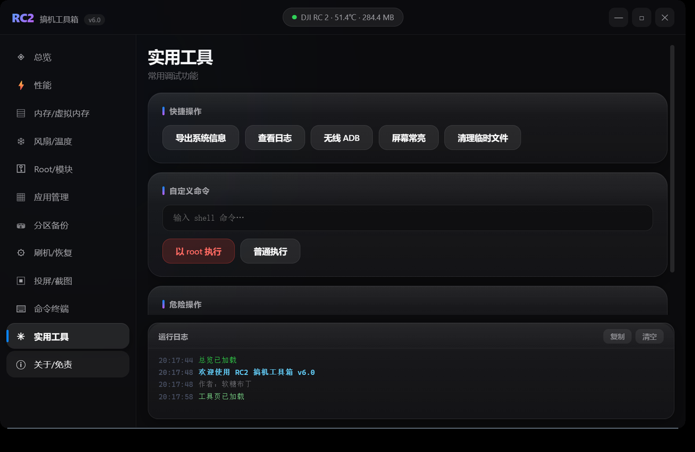
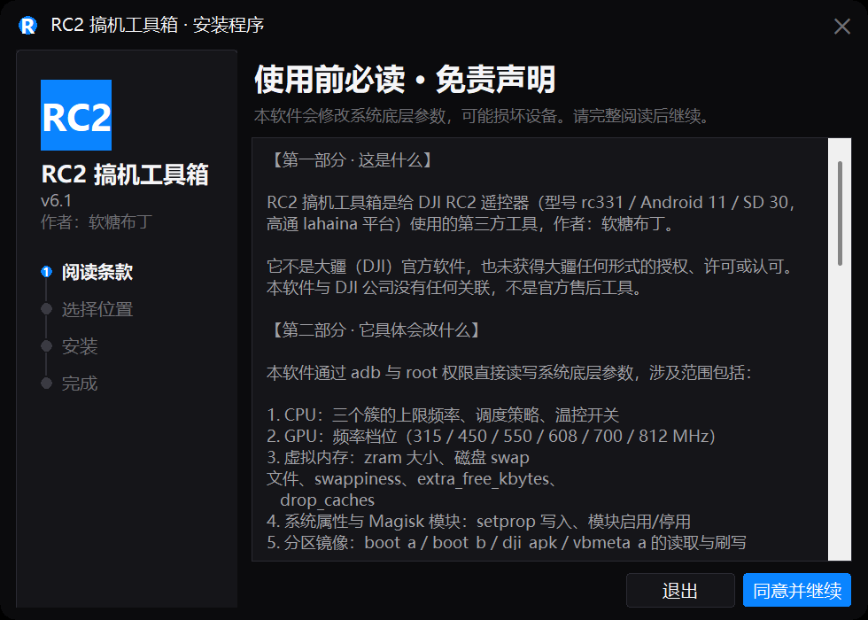
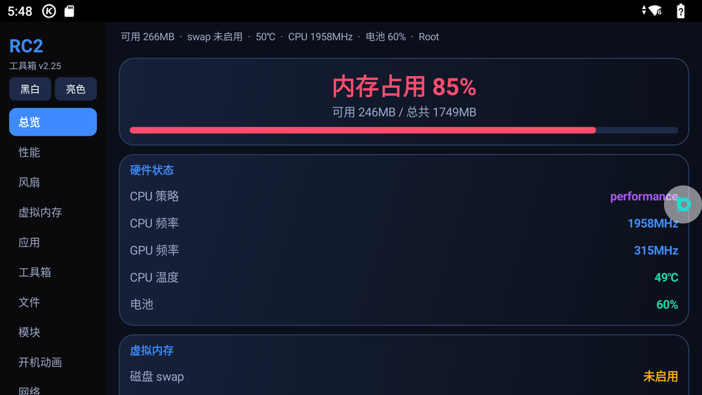

# RC2 破解

DJI RC2 那台带屏遥控器（rc331，高通 QCS5430，Android 11）。这里放着折腾它的过程和工具。

**不刷机，不解 BL**，先把 `uid=0(root)` 拿到手。之后要不要往下走，你自己决定。

[](https://github.com/456erddgr/rc2-unlock-toolkit/releases/latest)
[](https://github.com/456erddgr/rc2-unlock-toolkit/releases)
[](https://github.com/456erddgr/rc2-unlock-toolkit/stargazers)
[](#)
[](LICENSE)

真正天天用的工具在另一个仓库：[RC 搞机工具箱](https://github.com/456erddgr/rc-gaoji-toolbox)。
分区备份、ADB 直刷、投屏点击、无人机调参，双击就能用。

下载：[两个软件（工具箱 v6.16 + 遥控器版 v2.28）](https://github.com/456erddgr/rc2-unlock-toolkit/releases/tag/v6.16-pc-toolbox) ·
[Root ADB v7.19（教程视频、9 个模块、第三方 App 都在这）](https://github.com/456erddgr/rc2-unlock-toolkit/releases/tag/v7.19) ·
[123 云盘](https://1843626542.share.123pan.cn/123pan/VX07Td-v8SoA?pwd=nRmH#)（提取码 `nRmH`）

看哪儿：[四件套](#四件套) · [下载](#-下载) · [工具箱](#rc2-破解工具箱电脑版--遥控器版) ·
[两条命令用起来](#两条命令用起来) · [装好了怎么验证](#装完是什么样怎么验证) · [原理](#工作原理) ·
[常见问题](#常见问题) · [免责声明](#免责声明)

文档：[安装与使用指南](docs/安装与使用指南.md) · [技术记录](docs/技术记录.md)

---

## 四件套

| 部分 | 是什么 | 在哪 |
|---|---|---|
| **Root ADB** | 让 `adb shell` 直接进 `uid=0(root)`，重启后依然在；不刷机、不写分区、不烧 eFuse | `Root-ADB.exe`（见下面[下载](#-下载)） |
| **电脑版工具箱 v6.16** | 性能调频、内存/虚拟内存、风扇温度、Root 模块、应用管理、分区备份、刷机恢复（含 Magisk 刷 Root）、**投屏+点画面操作**、命令终端、扫描设备、自定义壁纸、**无人机参数调参（14 机型自动识别）**、**虚拟手柄（227Hz 推流）** | [Releases](https://github.com/456erddgr/rc2-unlock-toolkit/releases/tag/v6.16-pc-toolbox) |
| **遥控器版 APP v2.28** | 装进遥控器里点着用：总览/性能/风扇/虚拟内存/开机动画/文件/应用/模块/日志/网络/调参/简易调参 等 16 页 | [`remote/`](remote/) |
| **Magisk 模块 ×9** | adb 直通 root、免授权弹窗、26 个运维脚本（含黑屏急救）、zram/磁盘 swap、开机动画、酷狗保活、救砖保护… | [`modules/`](modules/) |

### 电脑版



全部工具（adb / fastboot / 界面 / 图标）都打包进 exe，不装 Python、不装依赖，拷到别的 Windows 10/11 双击就能用。

### 安装程序



原生界面，**不依赖 Microsoft Edge**，无白边无标题栏；自动建桌面与开始菜单快捷方式，附卸载脚本。

### 遥控器版



> 各版本改动见 [CHANGELOG.md](CHANGELOG.md)。

---

## 目录

- [四件套](#四件套)
- [下载](#-下载)
- [这是什么](#这是什么)
- [两条命令用起来](#两条命令用起来)
- [装完是什么样（怎么验证）](#装完是什么样怎么验证)
- [卸载 / 还原](#卸载--还原)
- [工作原理](#工作原理)
- [边界与风险](#边界与风险)
- [RC2 破解工具箱（电脑版 + 遥控器版）](#rc2-破解工具箱电脑版--遥控器版)
- [老工具箱 v7.19（可选）](#老工具箱-v719可选)
- [设备信息](#设备信息)
- [仓库里有什么](#仓库里有什么)
- [自己编译工具箱](#自己编译工具箱)
- [常见问题](#常见问题)
- [第三方组件与来源说明](#第三方组件与来源说明)
- [免责声明](#免责声明)
- [更新记录 CHANGELOG](CHANGELOG.md)

---

## 📥 下载

下面这几个是 **v7.19 那一套**（root + 教程 + 老图形界面）。想要最新的两个软件——工具箱 v6.16 和遥控器版 App v2.28——看下面[工具箱那一节的下载](#下载)。

| 下载方式 | 说明 |
| --- | --- |
| **GitHub Releases** | 点表格里的文件名就是直链，**不用登录 GitHub 账号** |
| **123 云盘** | 国内下 GitHub 经常卡住，用这个：👉 **[RC2 · 123 云盘](https://1843626542.share.123pan.cn/123pan/VX07Td-v8SoA?pwd=nRmH#)**　提取码 `nRmH` |

全部文件的清单（含每个多大、干什么用）在 **[DOWNLOADS.md](DOWNLOADS.md)**。

| | |
|---|---|
| ⭐ **核心（必下）** | [`Root-ADB.exe`](https://github.com/456erddgr/rc2-unlock-toolkit/releases/download/v7.19/Root-ADB.exe)（20 MB）—— 持久化 root ADB 安装工具 |
| ⭐ **前置（必下）** | [`ADB-Unlock-RC.exe`](https://github.com/456erddgr/rc2-unlock-toolkit/releases/download/v7.19/ADB-Unlock-RC.exe)（9.2 MB）—— Fly 网络 ADB 设置工具，先把 ADB 打开 |
| 🎬 **视频教程** | [`Tutorial.mp4`](https://github.com/456erddgr/rc2-unlock-toolkit/releases/download/v7.19/Tutorial.mp4)（1.04 GB） |
| 🧰 **图形界面** | [`RC2-Toolbox-v7.19.apk`](https://github.com/456erddgr/rc2-unlock-toolkit/releases/download/v7.19/RC2-Toolbox-v7.19.apk)（7.8 MB，可选） |

> 两个 exe 都是**在 Windows 电脑上**运行的（需要管理员权限）。遥控器那边不需要装任何东西就能完成 root。

---

## RC2 破解工具箱（电脑版 + 遥控器版）

这个仓库现在就是完整的 **RC2 破解** 项目：把 DJI RC2（rc331）的 ADB 变成持久 root，
外加一套电脑端「搞机工具箱」和一套装在遥控器里的「遥控器版」APP，以及 9 个 Magisk 模块。

### 下载

**GitHub**

| 要什么 | 点哪个 |
| --- | --- |
| 安装程序（推荐）。ViGEmBus 和 DJI 驱动都在里面 | [`RC2Toolbox-Setup-6.16.exe`](https://github.com/456erddgr/rc2-unlock-toolkit/releases/download/v6.16-pc-toolbox/RC2Toolbox-Setup-6.16.exe) · 96 MB |
| 绿色版。不写注册表，驱动自己装 | [`RC2Toolbox-6.16.exe`](https://github.com/456erddgr/rc2-unlock-toolkit/releases/download/v6.16-pc-toolbox/RC2Toolbox-6.16.exe) · 32 MB |
| 遥控器版 App v2.28 | [`RC2Toolbox-v2.28.apk`](remote/RC2Toolbox-v2.28.apk) · 398 KB |
| 9 个 Magisk 模块 | [`modules/`](modules/) |
| 源码、图标 | [`source/`](source/) · [`RC2Toolbox.ico`](RC2Toolbox.ico) |

**123 云盘**（GitHub 下不动时用）：**[点这里](https://1843626542.share.123pan.cn/123pan/VX07Td-v8SoA?pwd=nRmH#)**，提取码 `nRmH`。同一批文件，免登录不限速。

exe 为什么不进仓库？安装包 96 MB，大头是那两个 Windows 驱动。塞进 Git 历史，以后谁 clone 都难受。

### 电脑版能干什么

性能（三簇频率 1.96G / 2.4G / 2.7G + GPU 315-812MHz + 调度策略）、内存与虚拟内存（zram / 磁盘 swap /
swappiness / drop_caches）、风扇与温度（含背光急救）、Root 与 Magisk 模块、应用管理、分区备份（14 个分区）、
刷机恢复（Fastboot 识别 / BL 解锁 / 刷分区 / **Magisk 刷 Root 四步**）、**投屏 + 点画面直接操作遥控器**、
命令终端（ADB + Fastboot，可自己写命令）、扫描设备、自定义壁纸。

**刷 Root 的正确姿势**（Magisk 官方流程，工具只做第 1、4 步）：
提取 boot 镜像（同时就是备份）→ 传到遥控器 → Magisk App「安装 → 选择并修补一个文件」→
把 `magisk_patched-*.img` 拷回来 → 工具里「选择补丁镜像」→「刷入补丁」→ 重启。

刷坏了按住「返回键 + 电源键」进 fastboot，用「恢复备份」刷回去。

### 遥控器版（装在遥控器上的那个 APP）

```
adb install -r --no-incremental --abi arm64-v8a remote/RC2Toolbox-v2.28.apk
```

第一次打开先看条款，同意后永久记住。14 个页面：总览 / 性能 / 风扇温度 / 虚拟内存 / 应用 / 模块 /
开机动画 / 文件 / 日志 / 网络 等。

- **开机动画**：支持「同步原时长」（4 秒视频就播 4 秒）和「手动设置」，帧数 12-120、帧率 10-30 可调；
  生成时流式写 zip，不会把 1.7GB 内存吃爆。
- **虚拟内存关闭**：纯本地操作（swapoff → 写 disable 标记 → 删文件），秒级完成；再开也能自动重建。

### Magisk 模块（`modules/`）

进 Magisk App → 模块 → 从本地安装。最常用三个：
`02-adb-direct-root`（adb 一上来就 uid 0）、`03-toolbox-no-auth-popup`（省掉授权弹窗）、
`04-all-scripts-26-with-screen-rescue`（26 个运维脚本，含黑屏急救 `fix_screen.sh`）。

刷之前确认 `/data/adb/modules` 没有同名旧模块；刷完第一个先重启能正常开机，再刷下一个。

### 保命铁律

1. **不要 unexport pwmchip0**（屏幕背光），黑屏用 `sh /data/adb/modules/rc2_allscripts/scripts/fix_screen.sh` 救
2. **不要关 zram**，也不要一次 dd 超过 1GB（可用内存只有 1.7GB）
3. **不要回锁 Bootloader**——RC2 有大疆加密校验，回锁直接变砖（本工具已永久移除该功能）
4. `swappiness` ≤ 100，`extra_free_kbytes` ≤ 32MB
5. 刷分区只碰 `boot_a / boot_b / dji_apk / vbmeta_a`

### 已知限制

DJI 的 ROM 从 SELinux 层拦了 `app_process`，scrcpy 的服务端起不来（硬限制）。所以投屏是
「截图推流」约 1-2 帧/秒，能看能点能滑，但不是 60 帧游戏级投屏。点击是直接往
`/dev/input/event2` 写触摸事件（`input tap` 会被这台机器静默吞掉）。

---

作者：软糖布丁。本工具与大疆（DJI）无任何关系，未获授权或认可。
会改系统底层参数，可能导致过热/卡死/变砖/黑屏/数据丢失/保修失效，**后果自负**。

---

## 这是什么

RC2 出厂时 ADB 是关着的，而且 DJI 把系统自带的 `adbd` 改坏了 —— 协议层直接拒绝连接，写 `adb_keys`、无线配对、`settings put global adb_enabled` 全都无效（这一段踩坑记录在 [docs/技术记录.md](docs/技术记录.md)）。

**RC2 Root ADB 干的事，是把这台机器的 ADB 换成一个「对你有求必应」的版本：**

| | 出厂状态 | 装完 Root ADB 之后 |
|---|---|---|
| `adb devices` | 连不上 / `offline` | ✅ 正常识别 |
| `adb shell id` | 根本进不去 | ✅ `uid=0(root) gid=0(root)` |
| `adb shell` 能做什么 | — | ✅ 读写 `/data`、改系统属性、装/删系统 App、抓 `/dev/block` |
| capability | — | ✅ `CapEff=0000003fffffffff`（完整集） |
| 重启之后 | — | ✅ **自动恢复**（有开机自愈） |
| 装了什么在系统分区 | — | ❌ **一个字节都没改**，全在 `/data` 和 `/dji_apk` |

它由两段组成：

1. **`ADB-Unlock-RC.exe`**（Fly 网络 ADB 设置工具）—— 把 RC2 的网络 ADB 通道打开。**这一步会给出一个 root 权限的 ADB shell**，也是后面所有操作的前提。
2. **`Root-ADB.exe`**（RC331 持久化完整权限 Root ADB 安装工具 v1.4.5）—— 把上面那个「临时的、一次性」的 root shell **变成开机就在的常驻能力**。

> 一句话概括：**第一把钥匙是 `ADB-Unlock-RC.exe` 递的，`Root-ADB.exe` 负责配一把永远挂在门口的。**

---

## 两条命令用起来

### 前提

- Windows 电脑一台（Win 10/11），**用管理员身份运行**
- USB-C **数据线**（只能充电的线不行）
- RC2 开机、解锁屏幕
- 关掉电脑上的手机助手 / 其他 adb 服务（避免抢设备）

### 第 1 步：打开 RC2 的 ADB

双击 **`ADB-Unlock-RC.exe`**，管理员权限运行，按提示走完。

完成后**先自己验一下**（这一步很关键，很多人卡在这）：

```powershell
adb devices
# List of devices attached
# 127.0.0.1:5555   device        ← 有这一行才算通

adb shell id
# uid=0(root) gid=0(root) ...    ← 必须是 uid=0
```

> ⚠️ 如果这里不是 `uid=0`，**先别往下走**。第 2 步的工具自己也会校验，校验不过会直接报错退出（它宁可停下也不半成品）。

### 第 2 步：装持久化 Root ADB

双击 **`Root-ADB.exe`**，管理员权限运行。它是一个**全自动**的安装器，只连一台设备，屏幕上会把每一步的真实输出打出来：

| 步骤 | 它做了什么 |
|---|---|
| 1 | 找到唯一在线的设备，确认 `get-state = device` |
| 2 | 校验 shell 是 `uid=0(root)` 且 `CapEff=0000003fffffffff`（不满足就报错退出） |
| 3 | 校验机型是 `rc331`，读 SDK / build id / SELinux / 硬件序列号 / 系统 adbd 的哈希 |
| 4 | 安装内置的 `dev.rc331.rootadb`（显示名 **RC331 Root ADB**），并确认它没被系统冻结 |
| 5 | 从 APK 里解出 8 个载荷文件，逐个比对 `PAYLOAD_SHA256SUMS.txt` |
| 6 | 推到 `/data/local/tmp/rc331-root-adb-install`，执行 `bootstrap-install.sh` |
| 7 | 拉起 App 触发启动器 → 注入 → 起 `adbd-root` |
| 8 | 最多等 90 秒，等新 adbd 起来（按**硬件序列号**认，不会认错设备） |
| 9 | 打印证据（`pidof adbd-root` / `id` / `CapEff` / `init.svc.adbd`），**自动重启**遥控器，等 75 秒后再验一次 → 确认**重启后还在** |

看到 `boot_receiver_state=persisted` 和重启后复查通过，就算装好了。

> 💡 第 9 步的重启是**故意的**。不重启就只是「临时生效」，重启一次才证明开机自愈真的挂上了。

---

## 装完是什么样（怎么验证）

随便开一个终端：

```powershell
# 1. 直接就是 root，不需要 su、不需要 Magisk
adb shell id
# uid=0(root) gid=0(root) context=u:r:su:s0

# 2. capability 是满的
adb shell "grep CapEff /proc/\$(pidof adbd-root)/status"
# CapEff:	0000003fffffffff

# 3. 在跑的是我们自己的 adbd，系统那个已经停了
adb shell pidof adbd-root          # 一个 pid
adb shell getprop init.svc.adbd    # stopped
adb shell getprop service.adb.tcp.port   # 5555
```

**常用玩法：**

```powershell
# 装 / 卸任意 App（包括标记为不可卸载的系统预装）
adb shell pm install -r -d C:\path\app.apk
adb shell pm uninstall --user 0 com.example.bloat

# 改系统设置
adb shell settings put global airplane_mode_on 1

# 直接读分区（只读，安全）
adb shell "dd if=/dev/block/by-name/devinfo of=/data/local/tmp/devinfo.bin"
adb pull /data/local/tmp/devinfo.bin

# 看 root 通道自己的日志
adb shell cat /data/adb-persist/root-adbd.log
```

> ⚠️ **`adb shell` 是 root 了，但你敲的每条命令也是 root 了。** `rm -rf` 在这个身份下没有护栏。写 `/dev/block` 之类的操作仍然要当成不可逆操作来对待。

---

## 卸载 / 还原

`Root-ADB.exe` 自带卸载路径（带**二次确认**），做的是：

1. 先把所有载荷 + 日志 + `dumpsys package` **备份**到 `/data/local/tmp/rc331-root-adb-removed-<时间戳>/`
2. 打上维护标记 `/data/adb-persist/disable-custom-adbd`（让启动器以后主动跳过）
3. 删 `/dji_apk/.adb-dev`、`/data/adb-persist`、`/data/local/tmp/librc331_root_adb_agent.so`
4. `adb uninstall dev.rc331.rootadb`
5. 重启

重启后系统会回到自带的 `adbd`，`adb shell` 恢复成普通 shell。**系统分区从头到尾没被改过，所以「还原」= 删掉 `/data` 里的东西，这是干净可逆的。**

---

## 工作原理

这一节是这个项目最值得看的部分 —— 它解释**为什么不用刷机也能拿到 root**，以及**为什么这条路比刷机安全**。

### 整体链路

```
① ADB-Unlock-RC.exe
        │  打开 Fly 网络 ADB
        ▼
   adb shell = uid=0 (root, CapEff=0000003fffffffff)   ← 临时能力，重启就没
        │
② Root-ADB.exe  │  推 8 个载荷 + 跑 bootstrap-install.sh
        ▼
   /dji_apk/.adb-dev/adb-root-launcher        ← setuid 4755，任意 App 执行即 euid=0
        │  execve
        ▼
   /data/adb-persist/start-root-adbd.sh       ← 拿锁，检查是否已在跑
        │  am attach-agent system <agent>=exec=<helper>;arg=<injected>
        ▼
   system_server 内注入（全 capability）
        │  setsid adbd-root --root_seclabel=u:r:su:s0
        ▼
   127.0.0.1:5555 上是「我们的」adbd —— 无认证、root、全 capability
   同时 setprop ctl.stop adbd 把系统自带的那个停掉
        │
        ▲  开机时由 dev.rc331.rootadb 的 BootReceiver 重新递一次钥匙
        └──────────────────────────────────────────────┘
```

### 三个关键设计

**1. 真正的 root 来自 `adbd-root`，不是来自 `su`**

整条链里没有任何「提权漏洞」的味道 —— 载荷里带了一个 AOSP 的 `adbd` 二进制（`adbd-root`，ARM64），用 `--root_seclabel=u:r:su:s0` 起在 5555 端口。它本身就以 root 跑，所以连进来的 shell 天然是 root。**没有内核漏洞，没有内存破坏，没有竞态。**

**2. 开机自愈靠 `setuid` 启动器 + APK 的 BootReceiver**

重启后 `adbd-root` 当然没了。`dev.rc331.rootadb` 这个 App 监听 `BOOT_COMPLETED`，启动时执行 `adb-root-launcher`（`setuid 4755`），它 `execve` 那个脚本，脚本再走一遍注入。所以「重启后还在」不是靠常驻进程，而是靠**每次开机重新搭一次**。

**3. 启动脚本是幂等 + 带锁 + 会自愈的**

`start-root-adbd.sh` 里做了这些事：

- 有维护标记 `/data/adb-persist/disable-custom-adbd` 就直接退出（卸载流程用）
- 已经在跑且 `CapEff` 校验通过 → 只把系统 adbd 停掉，不重复启动
- 用 `mkdir` 原子锁 + 校验持锁进程的 `cmdline`，防止两个启动器打架
- 注入走 `am attach-agent system`，等最多 70 秒（140 × 0.5s）
- **超时失败会主动把系统 adbd 拉回来**（`setprop ctl.start adbd`）——不会把自己搞到连不上

日志全在 `/data/adb-persist/root-adbd.log`。

### 它为什么**不**走刷机那条路

网上讲「破解 DJI 遥控器」，绝大多数是**刷机**：解 BL → 拉固件 → `payload-dumper` 提 `boot.img` → Magisk 打补丁 → `fastboot flash boot_b`。这条路在 RC2 上代价特别大：

- `fastboot flashing unlock` 会**永久烧写 eFuse tamper bit，不可逆**，刷固件也恢复不了
- 烧完之后 DJI Fly 校验不过，报**错误码 15**，飞机应用直接不可用
- 后续如果误操作（比如 `erase` / 刷错镜像），**真的会变砖**

**Root ADB 这条路完全不碰 fastboot 的写命令，也不碰任何块设备。** 载荷全在 `/data/adb-persist`、`/dji_apk/.adb-dev`、`/data/local/tmp` 三个用户区目录里，删掉即还原。

---

## 边界与风险

必须说清楚，不粉饰：

| 事项 | 说明 |
|---|---|
| ⚠️ **第 1 步必须成功** | `ADB-Unlock-RC.exe` 拿不到 `uid=0` 的 shell，第 2 步就无从开始。工具会校验并明确报错，不会留下半成品。 |
| ⚠️ **改 `df:/dev/block` 依然危险** | root 之后你有能力写分区，**能力不等于安全**。本工具不写块设备，但你手敲的命令会。 |
| ⚠️ **不要在没有 root shell 时升级 DJI Fly** | 这是经验之谈：开发机在一次 DJI Fly 自动更新后落到了 fastboot 模式（可救：`fastboot continue`）。装好 Root ADB 之后，你有 root shell，可以先备份再升。 |
| ⚠️ **`init.svc.adbd = stopped` 是正常的** | 系统自带的 adbd 被主动停掉了，接管的是 `adbd-root`。别当成故障。 |
| ⚠️ **别同时开多个 adb server** | 电脑上如果有手机助手类软件抢 5037 端口，会出现「设备忽隐忽现」。 |
| ✅ **不需要解锁 BL** | 与 BL 状态无关。 |
| ✅ **不烧 eFuse** | 熔丝位只在 `fastboot flashing unlock` 时才烧。 |
| ✅ **不写系统分区** | `/system`、`/product`、`/vendor` 一个字节都不改。 |
| ✅ **可完全还原** | 卸载即回到原样。 |

---

## 老工具箱 v7.19（可选）

> 这一节讲的是**上一代**遥控器端工具箱（v7.19，源码在 `app/`，仅作历史保留）。
> 现在用的是**遥控器版 v2.28**，见上文〈RC2 破解工具箱〉一节，APK 在 [`remote/RC2Toolbox-v2.28.apk`](remote/RC2Toolbox-v2.28.apk)。


`RC2-Toolbox-v7.19.apk` 是这套东西的**图形外壳**，装到遥控器上直接在屏幕上点。它**不是必需的** —— Root ADB 装好之后，纯命令行已经什么都能干了。

它的价值在于「不想记命令」：临时 root 开关、su 进 PATH、系统属性编辑、DJI 隐藏工厂工具、文件/应用/进程管理、救援面板。源码在 [`app/`](app/)，25 个 Java 文件，纯 AOSP API，无第三方依赖。

| 标签 | 内容 |
|---|---|
| **首页 / 状态** | 一键探测（内核、`/data/adb/ksu`、`su` 是否生效、KernelSU App 装没装）；显示 root 通道双路状态 |
| **超级用户** | 白名单管理（`root(0)`/`system(1000)`/`shell(2000)` 永放行）；快捷授权按钮；从已装应用勾选；生成 `su` 前端 |
| **模块** | 浏览 `/data/adb/modules`，启用/停用/删除，装模块 zip |
| **设置 / 系统** | 临时 root 开关、`su` 进 PATH、内核补丁**只读**探测、系统属性编辑、DJI 隐藏工厂工具、文件/应用/进程管理、救援 |

> ⚠️ 工具箱的「临时 root」**只是把已有的 setuid 启动器再执行一次**（`TempRoot.java` 注释原话：「设备上先被安装好一套一次性载荷」）。**载荷是 `Root-ADB.exe` 装的** —— 所以顺序不能反：先 Root ADB，再装工具箱。

---

## 设备信息

| 项目 | 值 |
|---|---|
| 机型 | DJI RC2 带屏遥控器 |
| 内部代号 | KATMAI-IDP |
| 平台 / 板级 | `rc331` |
| SoC | Qualcomm QCS5430（lahaina） |
| 系统 | Android 11 |
| 内核 | 5.4.210-qgki（DJI 5.4.210） |
| CPU | Cortex-A55，**运行在 32 位 armv8l 模式** |
| 内存 | 1.75 GB |
| 固件版本 | V00.01.12.50 |
| 构建指纹 | `DJI/rc331/rc331:11/V00.01.12.50/11250:user/test-keys` |
| 系统签名 | **test-keys**（非 release-keys） |
| 序列号 / USB SN Hash | `[REDACTED]` |

**VID:PID**

| 模式 | VID:PID |
|---|---|
| 正常模式 | `2ca3:1021` |
| ADB 模式 | `18d1:4ee7` |
| DIAG 模式 | `05c6:901d` |

> ⚠️ **CPU 是 32 位的。** 绝大多数 arm64-only 的 APK 装了也跑不起来，需要 `armeabi-v7a`。工具箱 APK 已按此构建。

---

## 仓库里有什么

```
rc2-unlock-toolkit/
├── README.md                        # 本文件
├── DOWNLOADS.md                     # 完整下载清单（17 个附件，带直链）
├── SHA256SUMS.txt                   # 校验和
├── RC2Toolbox.ico                   # 工具箱图标
├── remote/                          # 遥控器版 APP（装在 DJI RC2 上）
│   └── RC2Toolbox-v2.25.apk
├── modules/                         # 9 个 Magisk 模块（电脑版/遥控器版都用）
├── source/                          # 电脑版 + 遥控器版源码压缩包
│   ├── pc-toolbox-src.zip
│   └── android-toolbox-src.zip
├── app/                             # 工具箱（可选 GUI）完整源码
│   ├── AndroidManifest.xml
│   ├── src/com/rc2/toolbox/         # 25 个 Java 文件，约 38 万字节
│   │   ├── TempRoot.java            # 临时 root：转一次 setuid 启动器
│   │   ├── RootAdb.java             # root adbd 状态 / 持久化
│   │   ├── AdbShell.java            # 自己实现的 ADB 线协议客户端
│   │   ├── SuProvider.java          # su 入口（ContentProvider）
│   │   ├── SuReceiver.java          # su 广播桥
│   │   ├── KsuActivity.java         # root 管理器（白名单/su/模块/PATH 注入）
│   │   ├── Rescue.java              # 救援（不经过 sh 的两条退路）
│   │   └── ...
│   ├── assets/
│   │   ├── rc331-root-adb/          # ★ Root ADB 的 8 个载荷（PC 版同源）
│   │   └── hidden.tsv               # DJI Fly 里的隐藏组件清单
│   └── res/
├── tools/build.ps1                  # 无 Gradle 构建脚本
└── docs/
    ├── 安装与使用指南.md             # 照着做就行
    └── 技术记录.md                   # 逆向过程与踩坑记录
```

**`app/assets/rc331-root-adb/` 里的 8 个载荷**（也就是 `Root-ADB.exe` 推到设备上的那套）：

| 文件 | 落到设备哪里 | 权限 | 作用 |
|---|---|---|---|
| `adb-root-launcher` | `/dji_apk/.adb-dev/` | **4755** | setuid 启动器，「钥匙」 |
| `librc331_root_adb_agent.so` | `/dji_apk/.adb-dev/` + `/data/local/tmp/` | 0755 | 注入到 system_server 的 agent |
| `cap_ptrace_injector` | `/dji_apk/.adb-dev/` | 0755 + capability xattr | 带 ptrace 能力的桥 |
| `set_file_inheritable` | 用完即弃 | 0755 | 给上面那个写 `security.capability` xattr |
| `adbd-root` | `/data/adb-persist/` | 0700 | AOSP adbd，ARM64 |
| `start-root-adbd.sh` | `/data/adb-persist/` | 0755 | 锁 + 注入 + 超时自愈 |
| `injected-start-root-adbd.sh` | `/data/adb-persist/` | 0755 | 注入后的落地脚本 |
| `bootstrap-install.sh` | 用完即删 | — | 安装器（校验设备/uid/SELinux 后铺设） |

`bootstrap-install.sh` 有三道硬校验，任何一条不满足就 `exit 1`：`id -u` 必须是 `0`、`ro.product.device` 必须是 `rc331`、SELinux **不能是 Enforcing**。

---

## 自己编译工具箱

**不需要 Gradle，不需要完整 Android SDK。**

需要：JDK 21、Android build-tools（`aapt2` / `zipalign` / `apksigner`）、`android.jar`（platform-30）、`dx.jar`（build-tools 29 里那个）。

```powershell
# 签名口令走环境变量，不要写进仓库
$env:RC2_KS_PASS  = "你的keystore口令"
$env:RC2_KEY_PASS = "你的key口令"

.\tools\build.ps1 -Project .\app -Out .\app\out
# 产物：app\out\signed.apk
```

> 两个已知坑（脚本已处理）：`aapt2` 无法处理含非 ASCII 字符的绝对路径，所以脚本会 `subst` 一个盘符；`d8`/R8 处理 `this$0` 外层捕获的内部类会 NPE，所以只能用 build-tools 29 的 legacy `dx`。
>
> 请用自己的 keystore。历史上用过的测试签名口令已公开，不要再用它签发布包。

---

## 常见问题

**Q：`ADB-Unlock-RC.exe` 跑完 `adb devices` 还是空的？**
A：按顺序查：① 换一根**数据线**、换一个 USB 口（RC2 很挑）；② 关掉电脑上的手机助手类软件；③ `adb kill-server && adb start-server`；④ `adb connect 127.0.0.1:5555` 手动连。

**Q：`adb devices` 显示 `unauthorized`？**
A：RC2 的网络 adbd 是免认证的，出现 `unauthorized` 一般是连到了别的设备。`adb devices -l` 看清楚，必要时 `adb disconnect` 全部再连。

**Q：第 2 步报「不是 uid=0」/ 直接退出？**
A：说明第 1 步没真正把 root shell 打开。**先回第 1 步**，用 `adb shell id` 确认是 `uid=0(root)` 再重跑。

**Q：装完 `su` 命令还是没有？**
A：**这是正常的。** 这条路不需要 `su` —— `adb shell` 本身就是 root。想要 App 内部也能调 `su`，那是工具箱的「su 进 PATH」功能，属于另一套东西。

**Q：`getprop init.svc.adbd` 是 `stopped`，坏了？**
A：正常。系统自带 adbd 被主动停掉，接管的是 `adbd-root`。用 `adb shell pidof adbd-root` 确认它在跑。

**Q：重启后 root 没了？**
A：先看 `/data/adb-persist/root-adbd.log`。常见原因：① `dev.rc331.rootadb` 被系统冻结（`pm enable --user 0 dev.rc331.rootadb`）；② 存在 `disable-custom-adbd` 维护标记（卸载流程留下的）；③ 开机自愈被某些省电策略拖后，等 1~2 分钟再试。

**Q：能装 KernelSU 内核模块吗？**
A：**不能。** 内核是 `5.4.210-qgki`，里面没有 KSU 代码，内核那一半无法从用户态补上。工具箱里的「内核补丁」是**只读探测**，如实报告失败原因，绝不写块设备。

**Q：会不会变砖？**
A：这条路**不写任何分区**，因此没有「砖」的路径。卸载即还原。真正危险的是你自己去执行 `fastboot flash` / `erase` / `flashing unlock`。

**Q：落了 fastboot 模式怎么办？**
A：**先别慌，这不是变砖。** `fastboot devices` 能认到机器就说明它活着，执行 `fastboot continue`（推荐）或 `fastboot reboot` 即可正常启动。

**Q：项目跟大疆有关系吗？**
A：没有。这是对**自己拥有的设备**做的安全研究记录，与大疆无任何关联，也未获其授权或认可。

---

## 第三方组件与来源说明

**这是本项目里最需要说清楚的一节。**

| 组件 | 来源 / 作者 | 说明 |
|---|---|---|
| **`Root-ADB.exe`（RC331 Root ADB 安装工具）** | 原作者 **Telegram [@degreeds](https://t.me/degreeds) / GitHub [lmdgreeds](https://github.com/lmdegreeds)**；原文件名 `RC331Setup.exe` | **著作权归原作者。** 本仓库分发的是**汉化增强版 v1.4.5**，仅做界面与提示中文化，核心安装逻辑来自原作者。原作者如要求移除，会立即处理。 |
| **`RC331 Root ADB`（`dev.rc331.rootadb`）** | 同上 | 随 `Root-ADB.exe` 内置分发，负责开机自愈。 |
| **`ADB-Unlock-RC.exe`（Fly 网络 ADB 设置工具）** | `Fly Network ADB` v1.0.0（`Fly-Network-ADB-Setup.exe`） | 第三方工具，本项目未获再分发授权，附带仅为本机备份。 |
| **RC2 工具箱（`app/`）** | 本项目作者 | 原创源码，MIT。 |
| KernelSU | [tiann/KernelSU](https://github.com/tiann/KernelSU) | GPL-3.0。仅参考 `resetprop` 与 CLI 兼容性，未在仓库内分发其二进制。 |
| Magisk | [topjohnwu/Magisk](https://github.com/topjohnwu/Magisk) | GPL-3.0。`magiskboot` 用于 boot 镜像处理。 |
| APatch | [bmax121/APatch](https://github.com/bmax121/APatch) | GPL-2.0。内核补丁思路参考。 |
| icanhack.nl | Willem Melching | DJI RM500 提权研究，**仅引用未再分发**。 |
| DUMLRacer / margerine | CunningLogic / jcase、fpv-wtf | DJI 协议与提权思路参考。 |
| AOSP | Google | Apache-2.0。`adbd-root` 基于 AOSP adb。 |

DJI、DJI RC2、DJI Fly 是深圳市大疆创新科技有限公司的商标。

---

## 免责声明

> **本仓库记录的是对自己所拥有的设备进行安全研究的完整过程。**

1. **这是你自己的设备。** 针对的是**你本人拥有**的 DJI RC2 遥控器。**请勿用于他人设备。**

2. **运行的是开源 Android。** RC2 底层是 Android（AOSP）——**开源系统**。在自有设备上获取 root、装第三方 App，是 Android 平台长期以来的常规做法。

3. **本项目不刷机。** 走 ADB 通道，不写任何分区、不解锁 Bootloader、不触发 eFuse。因此刷机路线才有的后果（熔断、校验失败、变砖）在这里都不存在。

4. **风险自负。** 拿到 root 之后，你敲的每条命令都具有 root 权限。作者不对任何后果负责。

5. **第三方内容。** 仓库中分发的 `Root-ADB.exe`、`ADB-Unlock-RC.exe` 等工具**著作权归各自原作者**，本项目未主张任何权利。若权利人认为本仓库内容侵犯其权益，请提 [Issue](https://github.com/456erddgr/rc2-unlock-toolkit/issues)，会立即处理。

6. **无担保。** 本项目按「现状」提供，不附带任何明示或暗示的担保。

---

<div align="center">

**动手前请重读一遍「[边界与风险](#边界与风险)」。**

本项目的那台 RC2 目前停在 fastboot 模式（能救，`fastboot continue` 即可）。

</div>


---

---
